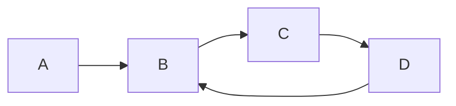
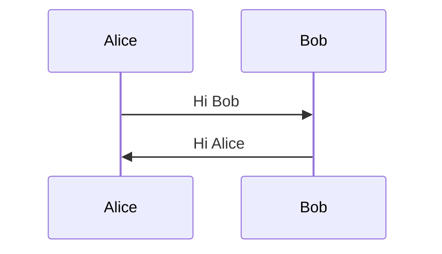

If you want to use [Mermaid-JS](https://mermaid-js.github.io/mermaid/#/) on your website.
Provide `mermaid` as [Shortcode](https://gohugo.io/content-management/shortcodes/#readout) in your markdown file.

Find more example on [Mermaid-JS](https://mermaid-js.github.io/mermaid/#/) website.
